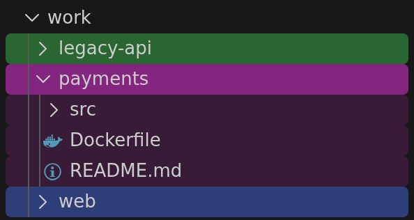

# Premium Explorer

Color folders in the VS Code Explorer, so you can tell your projects apart without
reading the names.

Point a rule at a folder. Either every Git repo under it gets its own stable color,
or you pick the colors yourself. Nothing is colored until you add a rule.

## Install

1. Install [Premium Explorer](https://marketplace.visualstudio.com/items?itemName=pepsik.premium-explorer)
   from the Marketplace.
2. **Make sure VS Code's own install directory is writable by you.** Row
   backgrounds have no extension API, so painting works by adding two lines to
   VS Code's `workbench.html` and dropping a small CSS/JS pair beside it — inside
   the application itself. A Windows User Installer download, a macOS `.app` you
   installed yourself or a Linux tarball in your home directory already are. A
   system-wide install (`Program Files`, `/usr/share/code`) is owned by
   Administrator or root and needs you to grant yourself write access first;
   Snap and Flatpak are read-only and cannot be patched at all. See
   [If VS Code is installed system-wide](#if-vs-code-is-installed-system-wide).
3. Run **Premium Explorer: Enable Background Painting** from the Command Palette.
   It tells you which directory it needs if it cannot write there, and changes
   nothing until it can.
4. Reload the window.

That is the whole setup. Steps 2 and 3 are needed once per VS Code install (see
[Why it patches VS Code](#why-it-patches-vs-code)); folder badges work without
any of it.

## Examples

Rules live in your user or workspace `settings.json`. Paths are workspace-relative
(`.`, `./notes`) or absolute.

**Every Git repo in a folder of projects gets a color:**

```jsonc
"premiumExplorer.rules": [
  { "path": ".", "engine": "git" }
]
```



The color is hashed from the repo name, so it is the same color tomorrow and on your
other machine. The examples below are single entries in that same list.

**One folder, your color:**

```jsonc
{ "path": "./notes", "rootBackgroundColor": "#00b8ff", "innerBackgroundColor": "#00b8ff" }
```

`root*` is the folder's own row, `inner*` is everything inside it. Inner rows are
tinted lighter by default (opacity `0.15` against the root's `0.5`).

**A deeper rule wins:**

```jsonc
"premiumExplorer.rules": [
  { "path": ".", "engine": "git" },
  { "path": "./work/payments", "rootBackgroundColor": "#e6194b",
    "innerBackgroundColor": "#e6194b", "rootMark": "docker" }
]
```

Everything is auto-colored, except `payments`, which is red and carries a whale.

Pills, gradient fills, watermarks, marks, edge bars and inherited inner rows each
have a screenshot and the rule behind it in
[docs/examples.md](docs/examples.md). Or open [`example/`](example/) in VS Code and
see all of it at once, one folder per case.

## Settings

A folder is painted in six independent layers: **background**, **edge** bar,
**pill**, **text**, **watermark** and **mark**. Each layer has a `root*` key for
the folder's row and an `inner*` key for the rows inside it. The same keys work on
a rule, where they apply to that folder only.

There are over a hundred of them. Open Settings, search `premiumExplorer`, and read
the descriptions there instead of here. The ones most people touch:

| Setting | What it does |
| --- | --- |
| `premiumExplorer.enabled` | Master on/off. |
| `premiumExplorer.palette` | The pool of automatic colors for `git` rules. |
| `premiumExplorer.colorBy` | Hash a repo's color from its `name` or full `path`. |
| `premiumExplorer.badge` | Up to 2 characters shown on colored folders. |
| `premiumExplorer.selected*` | How the selected row looks. |
| `premiumExplorer.git*` | How Git status letters and dots are colored. |

## Commands

- **Premium Explorer: Enable Background Painting**
- **Premium Explorer: Disable Background Painting (Restore Workbench)**
- **Premium Explorer: Refresh**

## Why it patches VS Code

VS Code has no API for Explorer row backgrounds. An extension can set a badge on a
label and nothing else. So Premium Explorer bakes your rules into a small CSS/JS
pair and adds two lines to `workbench.html` so the window loads them. The extension
works out the colors; that script paints the rows.

Things to know before you enable it:

- **VS Code will say the installation "appears corrupt."** `workbench.html` is
  checksummed, so any edit trips that banner. Safe to dismiss.
- **A VS Code update removes the patch.** Premium Explorer notices on the next
  launch and offers to re-apply.
- **Disabling restores the original file** byte-for-byte from a backup.
- **Desktop only.** Badges still work in the browser and in SSH, WSL and container
  windows; painting does not.
- It reads VS Code's internal DOM, which carries no compatibility promise.

### If VS Code is installed system-wide

The patch writes into VS Code's own install directory, so it depends on who owns it:

- **Already writable:** Windows User Installer (the default download), a macOS
  `.app` you installed yourself, a Linux tarball in your home directory.
- **Needs you to grant write access:** Windows System Installer in `Program Files`,
  Linux `.deb`/`.rpm` in `/usr/share/code`. A VS Code update takes ownership back,
  so expect to redo it. On Windows the permanent fix is reinstalling with the User
  Installer.
- **Cannot work at all:** Snap and Flatpak. The app is mounted read-only, so there
  is no permission to grant. Install the `.deb`, `.rpm` or tarball instead.

Premium Explorer checks before it writes, and leaves an install it cannot write to
exactly as it was. It will tell you which directory it needs. It will never run a
privileged command, ask for your password, or open a terminal for you. Granting
access is yours to do, deliberately, outside VS Code.

Folder badges need none of this and work everywhere.

## Development

```bash
pnpm install
pnpm run watch      # or press F5 for an Extension Development Host
pnpm run package    # type-check, lint, bundle
```

[CLAUDE.md](CLAUDE.md) explains how the pieces fit together.

MIT licensed.
