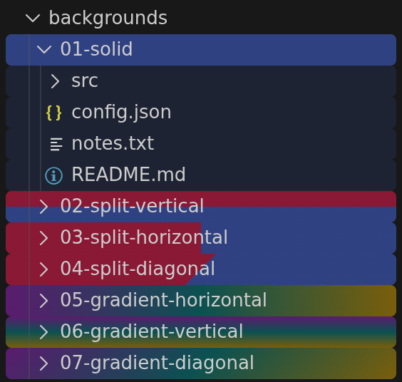
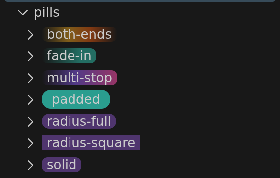
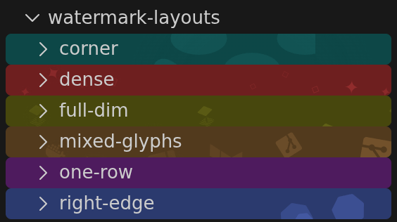
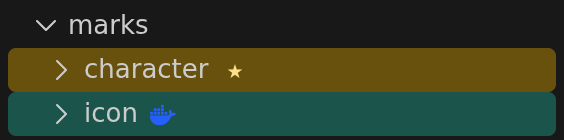
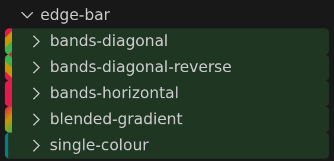
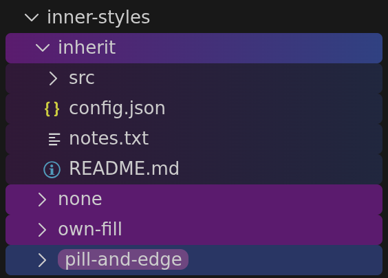

# Examples, with pictures

Every screenshot here is the Explorer painting [`example/`](../example/) — the
workspace in this repo that sets up each feature, one folder per case — beside the
rule that paints it. Open that folder in VS Code (with painting enabled, then
reload) to see all of it live.

Paths in a rule are workspace-relative (`.`, `./notes`) or absolute. `root*` keys
style the folder's own row, `inner*` keys everything inside it; the same keys exist
globally as `premiumExplorer.root*` / `premiumExplorer.inner*` defaults.

## A color, or a fill

```jsonc
{ "path": "./backgrounds/01-solid", "rootBackgroundColor": "#4363d8",
  "rootBackgroundOpacity": 0.55,
  "innerBackgroundColor": "#4363d8", "innerBackgroundOpacity": 0.14 }
```



Opacity `0.55` against `0.14` is what makes the contents read as *inside* the
folder. Swap the flat color for a `rootBackgroundFill` and you get the rows under
it: two colors split hard, or a multi-stop gradient, in any named direction or at
any angle.

```jsonc
{ "path": "./backgrounds/05-gradient-horizontal",
  "rootBackgroundFill": { "stops": ["#911eb4", "#008080", "#c99700"],
                          "direction": "horizontal" },
  "rootBackgroundOpacity": 0.55 }
```

A fill runs across the whole folder by default, not inside each row — see
[fill-spec.md](fill-spec.md) for what a stop, a direction and a scale mean.

## A pill behind the label

```jsonc
{ "path": "./pills/solid", "rootPill": "solid",
  "rootPillFill": { "stops": [{ "color": "#7c4db4", "alpha": 0.55 }] } }
```



A pill takes the same fills as a background. `rootPillRadius` runs from `0` (square)
to fully round, and `rootPillPadding` sets how far the plate reaches past the text.

## A logo behind the rows

```jsonc
{ "path": "./watermark-layouts/right-edge", "rootBackgroundColor": "#4363d8",
  "rootBackgroundOpacity": 0.45,
  "rootWatermarkStyle": "solid", "rootWatermarkLayout": "right-edge",
  "rootWatermarkSize": 18, "backgroundWatermarkSymbol": "kubernetes" }
```



Ships with `ansible`, `argo`, `claude`, `docker`, `fluxcd`, `git`, `kubernetes`,
`pulumi`, `terraform`. Any `.svg` path works too, and a list of names tiles them
together:

```jsonc
{ "path": "./watermark-layouts/mixed-glyphs", "rootBackgroundColor": "#9a6324",
  "rootBackgroundOpacity": 0.45, "rootWatermarkStyle": "solid",
  "backgroundWatermarkSymbol": ["docker", "terraform", "git"] }
```

`rootWatermarkLayout` puts the art across the whole block, in one row, at the right
edge or in a corner; `rootWatermarkDensity`, `rootWatermarkSize` and
`rootWatermarkCanvas` decide how crowded it is.

## A mark after the label

```jsonc
{ "path": "./marks/icon", "rootBackgroundColor": "#1f9e89",
  "rootBackgroundOpacity": 0.45, "rootMark": "docker", "rootMarkSize": 13,
  "innerBackgroundStyle": "none" }
```



A mark is one glyph or character, drawn where the label ends: a shipped name, any
`.svg` path, or a character like `"★"` wearing its own `rootMarkColor`.

## A bar down the edge

```jsonc
{ "path": "./edge-bar/bands-horizontal", "rootBackgroundColor": "#3cb44b",
  "rootBackgroundOpacity": 0.2,
  "rootEdge": "solid", "rootEdgeColors": ["#e6194b", "#c99700", "#3cb44b"],
  "rootEdgeBlend": "bands", "rootEdgeDirection": "horizontal", "rootEdgeWidth": 6 }
```



`bands` keeps the colors as hard stripes; `gradient` blends them. One color makes a
plain bar, and `rootEdgeRadius` rounds it into a capsule.

## Rows inside a folder

```jsonc
{ "path": "./inner-styles/inherit",
  "rootBackgroundFill": { "stops": ["#911eb4", "#4363d8"], "direction": "horizontal" },
  "rootBackgroundOpacity": 0.55,
  "innerBackgroundFill": { "stops": ["#911eb4", "#4363d8"], "direction": "horizontal" },
  "innerBackgroundOpacity": 0.2 },
{ "path": "./inner-styles/inherit/src", "rootBackgroundStyle": "inherit" }
```



`"inherit"` takes the enclosing folder's fill, so a nested rule does not restate it;
`"none"` leaves the contents untouched. Each layer decides this for itself, so a
folder can inherit its background and still carry a pill of its own.

## Everything else

[`example/`](../example/) also covers alpha gradients, rotation by degrees, block
versus row scale, corner radii, symlinked folders and the cases that are meant to
paint nothing — its [README](../example/README.md) has a line per group. The
authoritative list of settings is `contributes.configuration` in
[package.json](../package.json), or Settings with `premiumExplorer` typed in the
search box.
